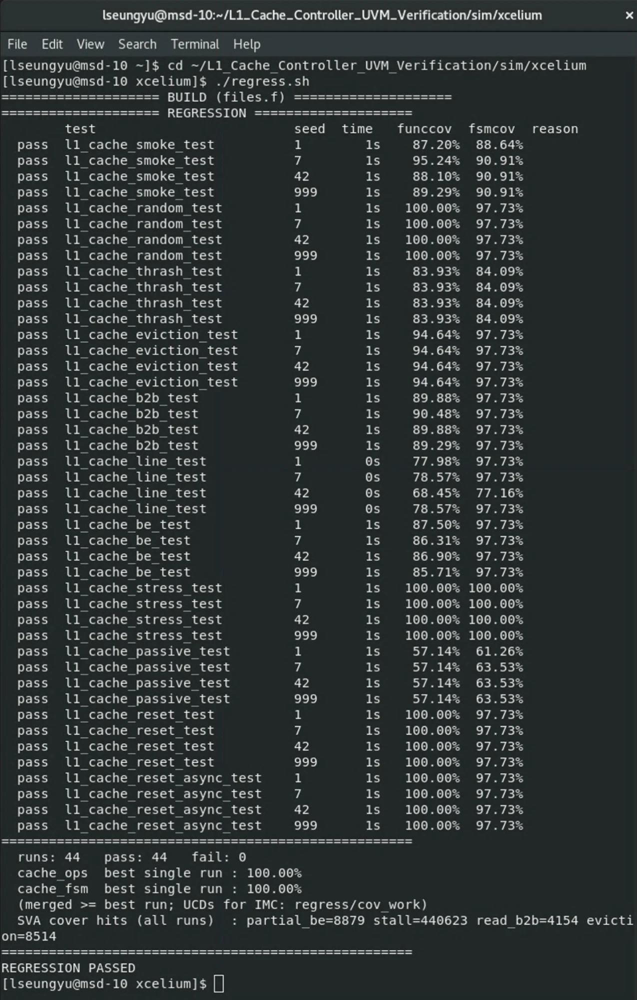
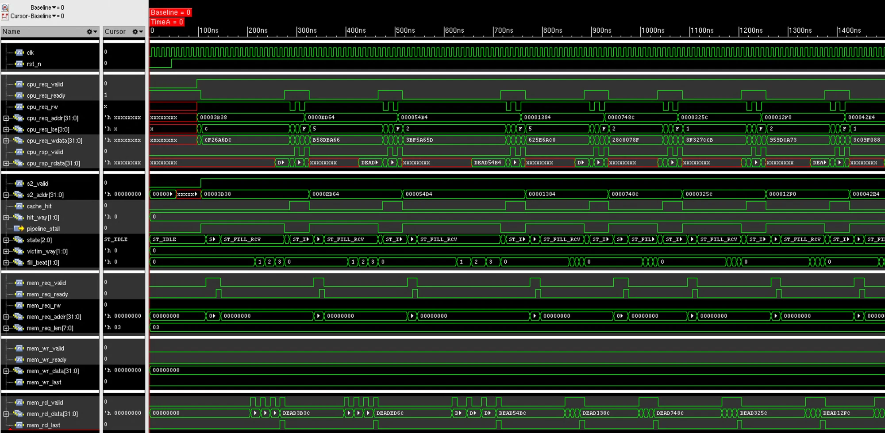

# Pipelined L1 Cache Controller — UVM Verification

A 4 KB, 4-way set-associative, write-back / write-allocate L1 data cache with a
2-stage pipeline, tree-PLRU replacement, 16-byte burst fills and evictions, and
byte-enable writes. It is verified with a UVM testbench on **Cadence Xcelium
24.09**, and the testbench itself was checked by injecting bugs into the RTL.

| | |
|---|---|
| Regression (11 tests × 4 seeds) | **44 / 44 pass** in ~20 s, UVM_ERROR 0, SVA failures 0 |
| X-propagation (`-xprop C`) | **44 / 44 pass**, every RTL block X-prop enabled |
| Seed sweep (11 tests × 20 seeds) | **220 / 220 pass** |
| Functional coverage | `cache_ops` **100%**, `cache_fsm` **100%** |
| Bug injection (32 RTL mutants) | **31 / 31 killed**, plus 1 mutant that is provably undetectable (equivalent) |

**What makes this testbench different**

- **Two independent checkers.** A cycle-accurate golden *cache* model predicts
  every hit, miss, victim, write-back and fill. A flat *architectural* memory
  separately checks that a load returns the last value stored at that address.
- **Bug injection, not just coverage.** 100% coverage only says a scenario
  happened. The mutation campaign shows that bugs in those scenarios are
  actually caught. It also exposed a blind spot that coverage could not: a
  data-loss bug that passed every test at 100% coverage ([§4](#4-does-the-testbench-catch-bugs)).
- **A reactive memory responder** with random latency, request backpressure
  and gaps between beats on both burst channels.
- **A reset agent** that resets in the middle of traffic, including mid-burst.

<p align="center">
  
</p>

---

## Contents

1. [Design](#1-design)
2. [Testbench](#2-testbench)
3. [Reading the waveform](#3-reading-the-waveform)
4. [Does the testbench catch bugs?](#4-does-the-testbench-catch-bugs)
5. [Running it](#5-running-it)
6. [Tests](#6-tests)
7. [Bugs found along the way](#7-bugs-found-along-the-way)
8. [Limitations and next steps](#8-limitations-and-next-steps)

```
rtl/            l1_cache_pkg, l1_cache_core (pipeline + miss FSM), l1_cache_top, sram_macro
tb/             interface + SVA, agents, scoreboard, coverage, sequences, tests
sim/xcelium/    Makefile, regress.sh, mutate.py, judge.sh, view.tcl   <- primary flow
sim/vivado/     Makefile, regress.bat / run.bat                        <- original xsim flow
```

---

## 1. Design


| | |
|---|---|
| Organisation | 64 sets × 4 ways × 16 B lines = 4 KB |
| Address split | `tag = addr[31:10]`, `set = addr[9:4]`, `word = addr[3:2]`, `byte = addr[1:0]` |
| Policy | write-back, write-allocate, byte-enable stores |
| Replacement | tree-PLRU (3 bits per set), invalid ways filled first |
| Pipeline | S1 presents the index to the tag/data SRAMs, S2 compares 4 ways and answers |
| Memory port | request channel plus separate write-data and read-data channels, 4-beat bursts with `LAST` |
| Latency | read hit 1 cycle; a miss stalls S1 for the fill, plus a write-back if the victim is dirty |

### Miss FSM

```
  ST_IDLE ──miss, clean victim──────────────────────▶ ST_FILL_REQ
     │                                                     │
     └─miss, dirty victim──▶ ST_WB_READ ──▶ ST_WB_SEND ────┘
                            (buffer line)   (stream out)   │
                                                           ▼
        ST_IDLE ◀──────────── ST_COMPLETE ◀──────────── ST_FILL_RCV
```

Each state has one job. `ST_COMPLETE` costs one extra cycle per miss, but it
removes the conflict between the last fill beat and the pending store's write.
It is also where tag, valid/dirty and PLRU are committed and the stall is
released.

### Three design points

- **Registered SRAM reads with per-byte forwarding.** A read samples the array
  before the same edge's write lands. If last cycle wrote the location being
  read, the core forwards the write data byte by byte, because a store may have
  written only some lanes. The forwarding compares against the address actually
  issued last cycle, not S2's address: during `ST_WB_READ` the read address
  walks the line.
- **No combinational loop.** The read address depends on `pipeline_stall`, but
  the read data is a flop output, so nothing loops back into the stall. With a
  combinational SRAM, `stall → raddr → rdata → hit → stall` would be a loop.
- **Valid, dirty and PLRU bits live in flops.** Reset flushes the whole cache in
  one cycle, with no invalidate walk and no X-compare tricks on an uninitialised
  tag array.

---

## 2. Testbench

```
tb_top
 ├─ bind l1_cache_fsm_cov -> l1_cache_core        (white-box FSM coverage)
 └─ l1_cache_env
     ├─ cpu_agt   sequencer + driver + monitor   ── req_ap / rsp_ap ─┐
     ├─ mem_agt   sequencer + burst responder + monitor ─────────────┤
     ├─ rst_agt   sequencer + reset driver       ── ap ──────────────┤
     ├─ scb       golden cache model + architectural memory ◀───────┘
     └─ cov       functional coverage ◀── scb.cov_ap
```

### Checking

| Checker | What it predicts | Catches |
|---|---|---|
| **Golden cache model** (`READ_DATA_BUG`, `MEM_*`, `WRITE_BACK_BUG`) | tag/valid/dirty/data for all 4 ways, the PLRU tree and DRAM: hit or miss, which way, the victim, its write-back address and beats, the fill burst and its data | wrong data, a spurious, missing, mis-addressed or mis-ordered burst, a wrong burst length, a wrong victim |
| **Architectural flat memory** (`ARCH_DATA_BUG`) | only "a load returns the last value stored there" | any data loss, even when the cache model shares the bug |
| **SVA** in `l1_cache_if.sv` (15 assertions) | handshake hold, payload stability, X/Z on every channel, line alignment, `len+1` beats with `LAST` on the final one | protocol violations |
| **`check_phase`** | no traffic, dangling reads, predicted bursts that never happened | a silent testbench passing |

The model is written **from the spec**: its own address decode and its own
3-node PLRU tree. It does not call the RTL's `l1_cache_pkg` helpers. Sharing
them is how a package bug once passed everything (section 4). A build-phase
check stops the run if the package geometry ever stops matching the model.

**Ordering.** The CPU monitor publishes every accepted request in issue order
(`req_ap`) and read data separately (`rsp_ap`). Expected data is snapshotted
when the read is issued and compared when it returns. The pipeline can retire
a miss in the same cycle it accepts the next request, so comparing against the
model's *current* state would give false failures.

**Reset.** The reset agent owns `rst_n` and tells the scoreboard just before
each reset, so the model flushes at the same moment as the DUT.
`reset_test` waits for an idle bus first. `reset_async_test` fires at any
moment, including mid-burst. A write-back cut in half leaves DRAM
unpredictable, so only that line is *poisoned* (its data checks are skipped).
Every protocol and ordering check stays live.

### Coverage

| Covergroup | Bins |
|---|---|
| `cache_ops` (fed by the scoreboard) | rw × hit/miss, eviction, victim state (cold / clean / dirty), way, word in line, set reach, byte-enable shape, 6 crosses |
| `cache_fsm` (bound into the core) | every state, the 7 legal transitions, 12 `illegal_bins` transitions, stall length, backpressure on both channels, fill-beat position, victim way, hit way |

Coverage comes from the scoreboard because hit/miss, way and victim state exist
only in the model, not on the pins. FSM transitions are covered as a
`{prev_state, state}` pair cleared by reset. Plain `=>` bins join the samples
on either side of a reset and report a false illegal transition. Each
`cover property` counts its hits and prints them as `[SVA COVER]`, and the
eviction count matches the scoreboard's exactly.

---

## 3. Reading the waveform

`make WAVE=1 TEST=l1_cache_be_test SEED=7` followed by `make view` opens this in
SimVision, with the signals already grouped by `view.tcl`:

<p align="center">
  
</p>

The byte-enable test writes a full word, overwrites some of its bytes, and reads
it back. The first miss, from the actual values in the database:

| Time | What happens |
|---|---|
| ~45 ns | `rst_n` releases |
| 96 ns | CPU writes `76D4B2AF` to `0x3B38` (`be=F`). It misses, and `cpu_req_ready` drops: S1 stalls |
| 115–145 ns | `ST_FILL_REQ`: request for line `0x3B30`. The responder withholds `mem_req_ready` for 2 cycles (backpressure) |
| 145–206 ns | `ST_FILL_RCV`: random memory latency |
| 206–276 ns | 4 fill beats `DEAD3B30 … DEAD3B3C` with random gaps, and `mem_rd_last` on the 4th. Never-written memory returns `DEAD` + address, so a beat in the wrong slot is visible |
| 275 ns | `ST_COMPLETE`: the store is merged into the new line, and `cpu_req_ready` returns |
| 285–315 ns | Two partial writes (`be=C`) and two reads hit. The reads return `CF26B2AF` and then `787DB2AF`: new upper bytes, old lower bytes |

Every following group repeats this for a new address (`0xED64`, `0x54B4`, …).
The cache is still cold here, so every victim is an invalid way and
`mem_wr_*` never moves. Write-backs appear later, once sets fill up.

---

## 4. Does the testbench catch bugs?

`sim/xcelium/mutate.py` injects one deliberate defect at a time into a copy of
`rtl/`, rebuilds it, and reruns the regression until the first failing run. An
unmutated baseline must pass first. Runs stopped by tool trouble (license,
wall-clock limit) are reported as `ERROR`, not counted as kills.

There are 32 mutants. 28 are in the controller: forwarding, hit and victim
logic, dirty and PLRU bookkeeping, write-back sequencing, burst framing, byte
enables, stall and reset. 4 are in `l1_cache_pkg`, the PLRU and address-split
helpers. A campaign takes about 100 s.

| | first campaign | after the fix |
|---|---|---|
| killed | 28 | **31** |
| survived | 3 — P01, P02, P04 | 0 |
| equivalent | 1 — C08 | 1 — C08 |
| score | 90.3% | **100%** |

**The survivors were a common-mode blind spot.** P01, P02 and P04 are bugs in
`l1_cache_pkg`, and the scoreboard used to call the same `plru_update`,
`plru_victim` and `get_word` as the RTL. The bug landed in the DUT and the model
together, so they agreed. P04 makes words 0 and 1 of a line alias: **stored data
is lost, and every test still passed at 100% coverage.** The fix was the
spec-derived model and the architectural check described in section 2. P04 now
fails with both `READ_DATA_BUG` and `ARCH_DATA_BUG`.

**C08 is equivalent, not missed.** "Fill the highest invalid way first" swaps
way *w* with 3−*w*. Tree-PLRU is symmetric under that swap, and every PLRU bit
is rewritten before a victim decision reads it. So hits, misses, victim lines
and write-backs are identical, and way numbers never reach the pins. It still
runs in every campaign, so if it ever dies, the reasoning is wrong.

First check to fire, across the 31 kills:

| Check | Kills |
|---|---|
| `READ_DATA_BUG` | 11 |
| `MEM_ADDR` | 8 |
| `MEM_DIRECTION` | 4 |
| `MEM_UNEXPECTED` | 3 |
| `WRITE_BACK_BUG` | 2 |
| `MEM_LEN` | 1 |
| `MEM_DRV` | 1 |
| `MON_SYNC` | 1 |

---

## 5. Running it

### Cadence Xcelium (`sim/xcelium`)

```bash
cd sim/xcelium

make                                    # build + run l1_cache_random_test, seed 1
make TEST=l1_cache_stress_test SEED=42
make XPROP=C                            # X-propagation build
make WAVE=1 && make view                # dump waves.shm, open it in SimVision
make GUI=1                              # interactive SimVision
make PLUSARGS="+NUM_TRANS=500 +SEQ=l1_cache_rand_seq"

./regress.sh                            # 11 tests x 4 seeds, 4 runs in parallel
./regress.sh -s "$(seq -s ' ' 1 20)" -j 8
./regress.sh -x C -o regress_xprop      # whole regression with X-propagation
python3 mutate.py                       # bug-injection campaign
```

| File | Role |
|---|---|
| `xrun.args` / `xrun_run.args` | build options / run-time options, written once |
| `regress.sh` | builds once, then runs each test/seed from the snapshot in its own `regress/runs/<test>_<seed>/` |
| `judge.sh` | the pass rule, shared with `make run`: the run reached the scoreboard report, `UVM_ERROR 0`, `UVM_FATAL 0`, and no simulator `*E`/`*F` |
| `mutate.py` | the mutant catalogue and campaign runner; writes `mutants/report.md` |
| `view.tcl` | SimVision layout used by `make view` |

Each run writes a UCD to `regress/runs/<test>_<seed>/cov_work/`, ready for an
IMC merge. `regress.sh` prints the best single run per covergroup. Both reach
100% in one run, so the merged score is 100% too.

<details>
<summary>Notes for the UH lab host (msd-10)</summary>

- `xcelium_env.sh` adds `/usr/local/cadence/XCELIUM2409/tools.lnx86/bin` to
  `PATH`. Set `XCELIUM_HOME` to use another install.
- Every tool needs `-64bit`. The 32-bit libz and libX11 are missing, and
  `make view` / `make GUI=1` already pass the flag. `export
  CDS_AUTO_64BIT=ALL` makes it the default for every Cadence tool.
- There is no `glibc-devel`, so the DPI export stub cannot be linked and
  xmsim prints `*E,IMPDLL`. Batch results are unaffected, and `judge.sh`
  allows exactly that code.
- There is no IMC on the host, so UCDs cannot be merged or reported there.

</details>

### Vivado xsim (`sim/vivado`)

The original flow (Vivado 2025.2, built-in UVM 1.2) is kept as it was. It last
passed 44/44 with 100% merged coverage (`xcrg`) before the Xcelium port. It has
not been re-run since the checker changes above.

```bash
cd sim/vivado && make regress           # Linux / WSL (set VIVADO_ROOT if needed)
```
```bat
cd sim\vivado && regress.bat            :: Windows
```

---

## 6. Tests

| Test | Scenario | `cache_ops` | `cache_fsm` |
|---|---|---|---|
| `l1_cache_smoke_test` | short run, gentle memory | 87–95% | 89–91% |
| `l1_cache_random_test` | mixed R/W over 8 tags per 4-way set (default) | 100% | 97.7% |
| `l1_cache_thrash_test` | whole-address-space random, nearly all misses | 83.9% | 84.1% |
| `l1_cache_eviction_test` | 6 tags per set, continuous PLRU eviction | 94.6% | 97.7% |
| `l1_cache_b2b_test` | back-to-back, VALID never drops | 89–90% | 97.7% |
| `l1_cache_line_test` | walk every word of a line after a fill | 68–79% | 77–98% |
| `l1_cache_be_test` | byte enables and per-byte forwarding | 86–88% | 97.7% |
| `l1_cache_stress_test` | slow memory, heavy backpressure on both channels | 100% | 100% |
| `l1_cache_passive_test` | passive CPU agent, pins driven by a BFM | 57.1% | 61–64% |
| `l1_cache_reset_test` | resets mid-traffic, bus idle first | 100% | 97.7% |
| `l1_cache_reset_async_test` | resets at any moment, including mid-burst | 100% | 97.7% |

Ranges are over seeds 1, 7, 42 and 999 on Xcelium. Each test targets a narrow
scenario, so per-test numbers are low by design.

---

## 7. Bugs found along the way

**Found on Xcelium and by bug injection**

| Issue | Detail |
|---|---|
| Scoreboard shared the DUT's helpers | three package bugs, one of which loses data, passed everything. The model is now independent, and the architectural check was added |
| Illegal FSM transition across reset | Xcelium raised `*E,EILLTB` in every reset test, which xsim had passed. `iff (rst_n)`-gated `=>` bins joined samples across the reset. Fixed with a reset-cleared `{prev_state, state}` pair |
| Covergroups not sampled | Without `-coverage U`, Xcelium reports 0% coverage, and the run still passed |
| No simulation timeout | A deadlocked DUT would run until UVM's 9200 s default. Now 5 ms by default; `+UVM_TIMEOUT` still overrides it |
| Published copy didn't compile | four `l1_cache_pkg` constants were missing |

<details>
<summary>Earlier fixes (xsim era)</summary>

**RTL**

- **Combinational loop.** `stall → raddr → rdata → hit → stall` was removed by
  making the SRAM read port registered.
- **Combinational SRAM model.** It made the core read the *next* request's
  index on an allocate→hit turnaround, causing 675 read mismatches.
- **Data-array forwarding** was added, and later made per byte.
- **Line geometry.** The tag/index split described a 16-byte line while the
  array held one word, so `0x100` and `0x104` aliased.
- **Architecture.** Went from direct-mapped to 4-way with PLRU, from 1-word
  lines to 4-word burst lines, and added byte enables.
- **Memory request.** It stayed asserted for the whole miss and was seen as
  repeated requests.
- **"Vault" entry.** It forced a hit without checking the tag and was removed.
- **Power-on X.** Fixed by moving valid/dirty into flops.
- **`always_comb` declaration initialisers** were static and ran once.

**Testbench**

- **`$error` in SVA** did not increment `UVM_ERROR`, so failing assertions
  passed. Assertions now use `uvm_report_error`, confirmed with a deliberately
  failing assertion.
- **Coverage was dead code.** It was never built or sampled.
- **The scoreboard only modelled memory.** It was rebuilt as a full cache
  model with issue-time snapshots.
- **Memory responder** was zero-latency and always ready; it now has random
  latency, backpressure and beat gaps.
- **Two assertions keyed off an undriven signal** and passed vacuously.
- **The b2b driver** dropped VALID between items, so back-to-back traffic
  wasn't really back-to-back.
- **`disable fork` in the memory driver** corrupted the sequencer handshake.
- **Loop-body declaration initialisers** were evaluated once by xsim, which
  collapsed 24 lines into 1.
- **Single-letter helper formals** shadowed call-site locals and silently
  passed 0.
- **Added** a config object, a test hierarchy, `check_phase`, a passive-mode
  test and clocking blocks.

</details>

---

## 8. Limitations and next steps

- **Non-blocking misses (MSHR).** This is the largest remaining item.
  Hit-under-miss returns reads out of program order, so it needs response IDs
  on the CPU port and an ID-matching scoreboard.
- **No RAL.** The DUT has no registers. A CSR block (enable, flush,
  hit/miss counters) would make a register model meaningful.
- **Code coverage is collected but not reported.** That needs IMC. There is
  also no gate-level run and no formal run, although the SVA are written so a
  formal tool could take them as-is.
- **Async reset poisons at most one line per reset.** Adopting the observed
  fill data would restore full checking.
- **The mutants are hand-written and single-site.** An operator-based mutator
  would explore corners nobody listed.
- **Smaller items:** parameterised geometry, critical-word-first fill, and a
  write buffer.
